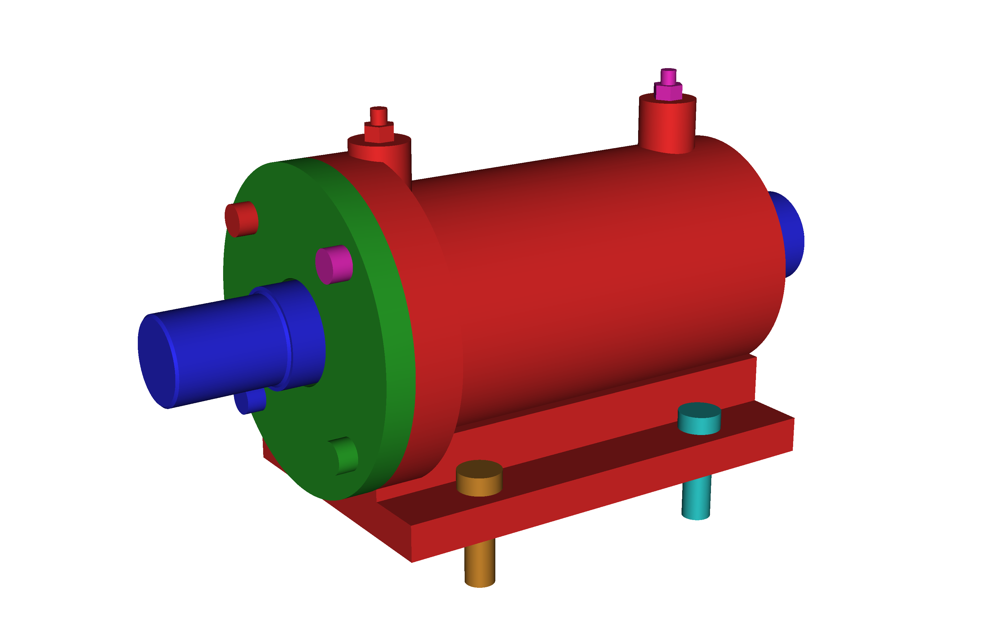

# conveyor_shaft_unit: a two-bearing shaft support unit from one paragraph, clean first time, and a system that then caught its own mistakes

> 3 designed parts, each right first time · 2 one-constant repairs, no repair loop · 9 catalogue items (22 pieces) · 17 components placed · 136-pair interference sweep · 6 STEP/STL exports · 15 agent spawns · 1 session · 0 valid gate rejections · 0 conflicts · reviewer verdict: ship (0.97) · then re-measured by the run's own verification: pause for a human, three installation defects open

**What it is.**
A bearing support unit for a 40 mm conveyor drive shaft:
a turned C45 steel shaft,
a single grey-iron housing with two in-line bores and a four-bolt mounting foot,
and a bolted steel cover carrying a radial lip seal,
sized around two 6208 deep groove ball bearings and seven other catalogue items
(a DIN 471 circlip, a 40 × 62 × 10 lip seal, four M8 cap screws,
four M12 foot bolts with washers and nuts, two grease nipples).
The input was the one-paragraph brief in `goals.md`, with no sketch:
shaft diameter, speed, loads, service life, bearing size, fits, chamfers, a minimum wall, and a grease nipple reachable from above.
This is the gallery's first run of a mechanically conventional machine element,
the kind of object a bearings catalogue is written around,
and it is here because of what the run did with the brief's own numbers,
not because of how the part looks.

**What it shows.**

- **Every dimension the brief named was measured on the finished model, not read off the plan.**
  Shaft seats Ø40.000 (a probe volume of 12,566.371 mm³ against an analytic 12,566.371),
  both housing bores Ø80.000 on one axis (a Ø80 probe passes the far bore with 0.000 mm³ of contact; Ø81 bites),
  an 18.000 mm clamp between the shaft collar and the circlip groove (the 6208's width exactly: zero drive-end float),
  1.500 mm of axial float at the free end,
  four 1.000 mm shoulder chamfers,
  and an 8 mm minimum wall that is 99.675 % intact,
  the deficit being one deliberate Ø4 grease drilling per bore to within 0.15 mm³.
  All in `smoke_report.md` §1 and §2, every figure re-measured from the solids in a thread independent of the agents that built them.
- **The planner's arithmetic was audited against the brief before the housing was cut.**
  Five rulings, all free at that moment, all in `design_log.md`:
  a flange boss grew from Ø124 to Ø130 because the rim outboard of an M8 thread was 6.0 mm under an 8 mm wall rule;
  the boss thickened from 10 to 20 mm so a 16 mm thread had metal behind it;
  the grease nipples moved to the housing's top face so the thicker boss could not bury them;
  the foot extended under the boss;
  the cover spigot lengthened to clamp the bearing's outer ring instead of leaving it 6 mm free to walk.
- **Sourcing found what no geometry check can.**
  ISO 281 arithmetic put the specified 6208's life at the stated load at 14,094 hours against the 20,000 the brief asks;
  the system kept the customer's bearing, costed three resolutions (accept the interval, upsize to a 6308 and re-run two parts, reduce the thrust)
  and marked the question `NEEDS_HUMAN_INPUT` rather than silently moving a number the brief fixed (`open_issues.md` ISSUE-001).
  The reviewer endorsed it and added that the ~1,300 hour grease relubrication interval defeats a literal "20,000 hours between services" for any bearing.
  The same pass shortened the cover screws from M8 × 30 to M8 × 25 after finding the longer screw bottoms in a 16 mm tapped hole.
- **A real clash, found by asymmetry, fixed with one constant.**
  The assembly sweep found the drive-end flange clipping both drive-end foot-bolt heads by 6.437 mm³
  while the far-end pair measured exactly 0.000;
  on a symmetric design that asymmetry is what separates a defect from a modelling convention.
  One constant moved the four foot holes 20 mm inboard; the re-check read 0.000 mm³ at all four stations,
  the holes proven twice over (a probe volume of 66.445 mm³ against analytic 66.445, and a face count of four).
- **The system overruled its own checker, on measured grounds.**
  The regression gate rejected that fix after snapshotting the proposal as its own baseline,
  comparing identical geometry (scoring it 0 on one pass and 1 on the next),
  and citing a rule its own report marks as passing.
  The orchestrator overrode it on four grounds, each a number
  (the hash equality, the contradicting report, an identical volume of 1,281,894.1 mm³ before and after, and the brief's hard requirement that four foot bolts fit),
  then reproduced the clash from independent code with a probe it had first checked against a closed-form volume.
  Three gate infrastructure failures on one part are recorded as harness defects in `open_issues.md` ISSUE-006; see ADR 0020 in the flagship repository for what changed because of them.
- **Then it caught itself.**
  The sign-off reviewer returned `ship` at 00:12.
  The manufacturing reviewer, still running, finished at 00:44 with two criticals:
  the M12 foot bolts cannot take the washer the run's own BOM mandates (45.016 mm³ of iron inside the washer's envelope at every station) or any socket,
  because the earlier fix had been proven against a plain Ø18 cylinder, the only bolt head the assembly modelled;
  and the documented assembly order asks an 80 mm bearing to pass a 72 mm passage (99.3 % of the swept volume is iron; a valid order exists and is written down).
  A verification pass re-measured both from scratch and confirmed them.
  Its own first draft then dismissed three mirrored bearing-shoulder overlaps as artifacts of sharp-cornered bearing primitives;
  a self-review caught that the catalogue rule it leaned on governs a fillet, not a 45° chamfer,
  rebuilt the ring with its real r 1.1 corner and measured it:
  both rings seat 0.3556 mm proud (closed form c − 0.586 R = 0.3556), leaving 17.644 mm for an 18.000 mm ring, so the circlip cannot be fitted.
  The brief's own 1 mm chamfer is the one value a 6208's corner cannot accept
  (a 45° fill chamfer of leg c clears a ring corner radius R only when c ≤ 0.586 R; the run's own files also state an upper branch, c ≥ 3.414 R, which a later measurement refuted: a 4 mm chamfer seats the ring 3.36 mm proud).
  The verdict was downgraded in writing, with the numbers, and the conflict escalated to the human rather than corrected silently
  (`smoke_report.md` §4, `open_issues.md` ISSUE-008/009/010, and the superseding banner at the top of `checkpoint.md`).

**What a human engineer still does.**
Decide the two conflicts the brief contains (bearing life; the shoulder detail, which wants a fillet of ra ≤ 1.0 or an undercut);
apply the proposed foot-bolt fix and re-run the sweep with washers, nuts and real corner radii in the assembly;
rewrite the assembly order;
produce drawings with tolerances beyond the fit classes, a seal lead-in taper and cover jacking holes;
run the bearing life and grease calculation properly;
specify material certification, casting draft and radii, which the system defers by standing policy.
The housing's manufacturability pass is weak evidence: the rulebook held no casting rules at the time of this run.
The models and the bill of materials are a starting point for an engineer, not a release package.

**How to read this run.**

| File | What it is |
|---|---|
| `iso_filled.png` | Shaded isometric, rendered post-run from the run's own `assembly.py` and colour legend (the pipeline's built-in renderer is wireframe-only by design) |
| `goals.md` | The brief, verbatim, with the success criteria the run was held to |
| `design_plan.md` | The plan: parts, interfaces, the resolved dimension spine (five numbers were superseded by rulings mid-run; `checkpoint.md` lists them, the plan was deliberately left as the planner wrote it) |
| `design_log.md` | The agents' decision trail, including the five rulings and the gate override (later entries carry local-time stamps with a `Z` suffix; see `run_reflection.md` §2) |
| `open_issues.md` | Ten issues: the two conflicts with the brief, the three open installation criticals, and three harness defects the run diagnosed in itself |
| `checkpoint.md` | The session's closing record, with the superseding banner written by the verification pass |
| `dfma_review.md` | The manufacturability and assembly review as the orchestrator consolidated it from the machine reports |
| `smoke_report.md` | Every success criterion and every brief-named dimension re-measured on the solids; the confirmed defects; the report's own correction of its first draft, kept in place |
| `run_reflection.md` | **The run's own debrief**: what failed, what healed, what the harness should change |
| `external/` | The bill of materials (nine catalogue items against published standards, three figures marked UNVERIFIED rather than invented) and the duty arithmetic behind it |
| `assembly/<part>/` | Per-part CadQuery source, constraints, renders (8 views), DFM report, and `exports/` (STEP + STL) |
| `assembly/` | `assembly.py` placing 17 components, the assembly notes, the DFA report, and 8 coloured assembly views with their legend |

Produced end-to-end by [AI-CAD](https://github.com/ai-cad-labs/ai-cad).
