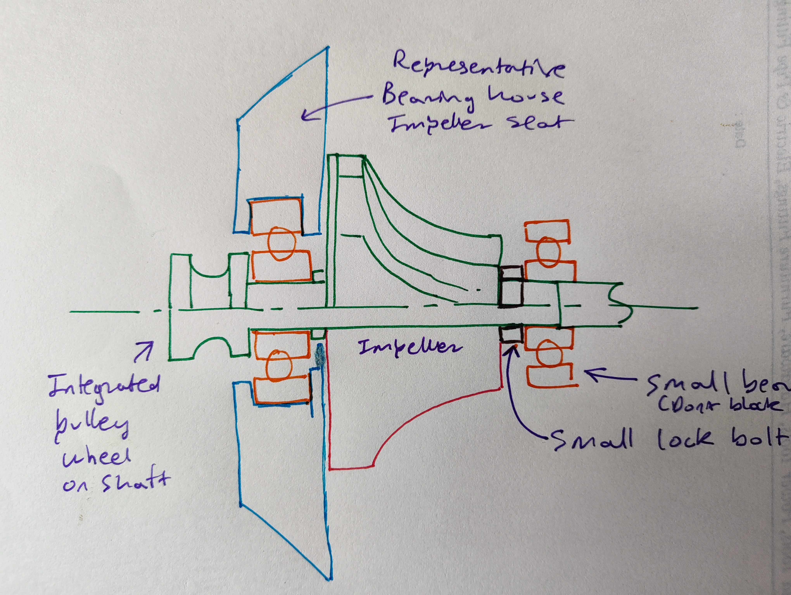

# impeller_assembly: a centrifugal compressor, designed from a hand sketch, and defended from its own tooling

> 6 components (3 designed · 3 catalog) · 0.8000 mm running clearance, measured five independent ways · 6 backswept blades, 10.5° measured backsweep · 6 STEP/STL exports · 14 agent spawns across 2 sessions · 1 repair cycle · 0 conflicts · ~2h12m · reviewer verdict: ship

**What it is.**
A small belt-driven centrifugal air-compressor core:
integrated pulley-shaft (one turned part),
an upright bearing housing,
and a 6-blade backswept compressor impeller,
sized around three catalog components
(a 6203 main bearing, a 688-2Z inlet bearing, an ISO 4032 M10 lock nut).
The input was a hand-drawn cross-section sketch plus a five-bullet brief,
the first image-input run in this gallery:
the sketch above, the prompt in `goals.md`, and the parts below it
are the complete provenance chain, end to end.

**What it shows.**

- **The system argued with its own tooling, and won for the user.**
  Mid-run, the DFM evaluator (judging the wheel under a mis-selected 3-axis
  milling ruleset) recommended cutting the impeller to 4 blades
  and straightening them into flat radial walls.
  That advice would have quietly destroyed
  exactly what the brief asked for: backswept blades.
  Both orchestrator generations refused it,
  recorded the refusal loudly in `open_issues.md`,
  and passed an explicit do-not-comply guard downstream
  so no later agent could obey it by accident.
  User intent held as a first-class constraint,
  not one voice in a negotiation the tool usually wins.
- **A vision miscount was refuted by geometry, not trusted.**
  The DFM report asserted the wheel has five blades (it has six).
  Instead of "repairing" a correct part,
  the validator settled it numerically:
  section cuts at three radii each returned exactly six disjoint solids
  at 60.00° spacing.
  A miscount that invents a defect manufactures damaging work;
  this run caught it before any was done.
- **The headline requirement is a machined dimension, not a hope.**
  The brief asked for 0.5-1.0 mm of running clearance
  between the impeller backface and the housing.
  Delivered: **0.8000 mm**,
  confirmed by five independent measurements
  across three agents and two orchestrators,
  and realized structurally, as a Ø22 × 0.8 standoff boss
  bearing on the 6203's inner race,
  so the clearance is machined into a part
  rather than left to an assembly stack-up that can drift.
- **Sizing anchored on catalog reality.**
  The bearings set the dimensions, not the other way around;
  and sourcing caught two real traps on the way
  (the open 688 is 4 mm wide, not the assumed 5;
  a DIN 934 nut would overhang the hub nose where ISO 4032 clears it).
- **One genuine defect, one surgical fix.**
  Assembly validation found two foundation bolts
  socket-blocked under the impeller's overhang.
  The repair changed two parameters
  (foot width 80 → 108, bolt circle ±32 → ±46),
  passed the regression gate,
  and the clearance re-verified unchanged.
- **A mid-run succession, survived.**
  Session 1 checkpointed itself at a clean boundary;
  a cold second session resumed from `checkpoint.md` alone
  and carried validation, review, and export to completion.
  The checkpoint's survival notes took child-agent losses
  from 7-of-10 in session 1 to 0-of-4 in session 2.

**How to read this run.**

| File | What it is |
|---|---|
| `user_initial_sketch.jpeg` | The hand-drawn input: where everything started |
| `iso_filled.png` | Shaded isometric, rendered post-run from the run's own assembly geometry and color legend (the pipeline's built-in renderer is wireframe-only by design) |
| `goals.md` | The brief: the user's spec verbatim, plus the system's sketch reading |
| `design_plan.md` | The plan: parts, interfaces, the locked dimension chain, build order |
| `design_log.md` | The agents' step-by-step build log |
| `open_issues.md` | 10 issues, including the blade-refusal record and two harness bugs the run itself diagnosed |
| `checkpoint.md` | The handover baton session 2 resumed from |
| `smoke_report.md` | The measured evidence: every success criterion, with numbers |
| `run_reflection.md` | **The run's own debrief**: the full story, in the run's own words |
| `external/` | BOM and sourcing notes for the three catalog parts |
| `assembly/<part>/` | Per-part CadQuery source, renders, and `exports/` (STEP + STL) |
| `assembly/renders/` | Multi-view renders of the assembled machine |

Produced end-to-end by [AI-CAD](https://github.com/ai-cad-labs/ai-cad).
