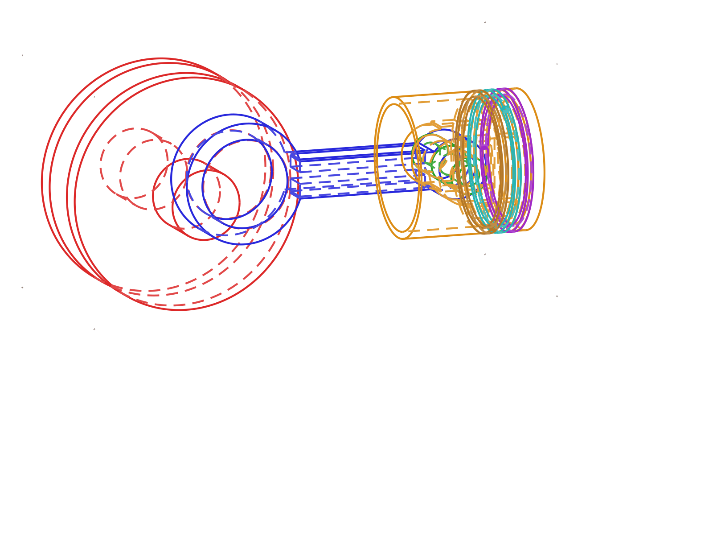

# piston_crank: a five-part engine core, planned, built, and proven by autonomous agents

> 5 parts · 7-instance assembly at top-dead-center · 10 STEP/STL exports · ~19 agent spawns across 2 sessions · 0 negotiation rounds · 1 precision repair cycle · 71.3 min · fully autonomous

**What it is.**
The reciprocating core of a single-cylinder IC engine:
piston, crankshaft, connecting rod, gudgeon (wrist) pin, and piston ring.
Assembled at top-dead-center as 7 placed instances (the ring used ×3, gaps clocked ~120°).
The system planned the mechanism, wrote parametric CadQuery source for all five parts,
validated each against its own constraints, composed and verified the assembly,
and exported STEP + STL for every part:
10 CAD files and 8 render views per part, all agent-authored.

**What it shows.**

- **A fit chain locked up front, and held to the end.**
  Before any geometry existed,
  the planner fixed every fit and clearance numerically:
  pin ⌀15.99 ↔ bores ⌀16.02, crank pin ⌀38 ↔ big end ⌀38.05,
  ring section 2.5×2.5 ↔ groove 2.6×3.0,
  rod centres 95 + crank throw 30 → piston crown at exactly 125.
  The whole chain survived five parts, a repair, and final assembly with zero drift.
- **Interference-free, proven by arithmetic.**
  The assembled volume (333,808.54 mm³) equals the exact sum of the seven part volumes:
  no interpenetration anywhere in the mechanism,
  demonstrated by math rather than by eyeballing renders.
- **One flaw found, one surgical fix.**
  Validation caught a genuine machinability flaw in the piston:
  an undercut above the pin bosses that a milling tool could not reach.
  The repair changed a single parameter (web width 24 → 28 mm),
  cleared every finding in one cycle,
  and left all locked interfaces untouched.
  No thrash.
- **A planned mid-run handover.**
  Rather than push one long-running session to its limit,
  the first orchestrator checkpointed itself at a clean boundary (all 5 parts validated)
  and a second session resumed cold from `checkpoint.md` alone,
  then carried assembly, review, and export to completion.
  Succession by design, exercised live.

**How to read this run.**

| File | What it is |
|---|---|
| `goals.md` | The design spec the system authored for itself |
| `design_plan.md` | The plan: parts, interfaces, the locked dimension chain, build order |
| `design_log.md` | The agents' step-by-step build log |
| `checkpoint.md` | The handover baton session 2 resumed from |
| `run_reflection.md` | **The run's own debrief**: the full story, in the run's own words |
| `assembly/<part>/` | Per-part CadQuery source, renders, and `exports/` (STEP + STL) |
| `assembly/renders/` | Multi-view renders of the assembled mechanism |

Produced end-to-end by [AI-CAD](https://github.com/ai-cad-labs/ai-cad).
