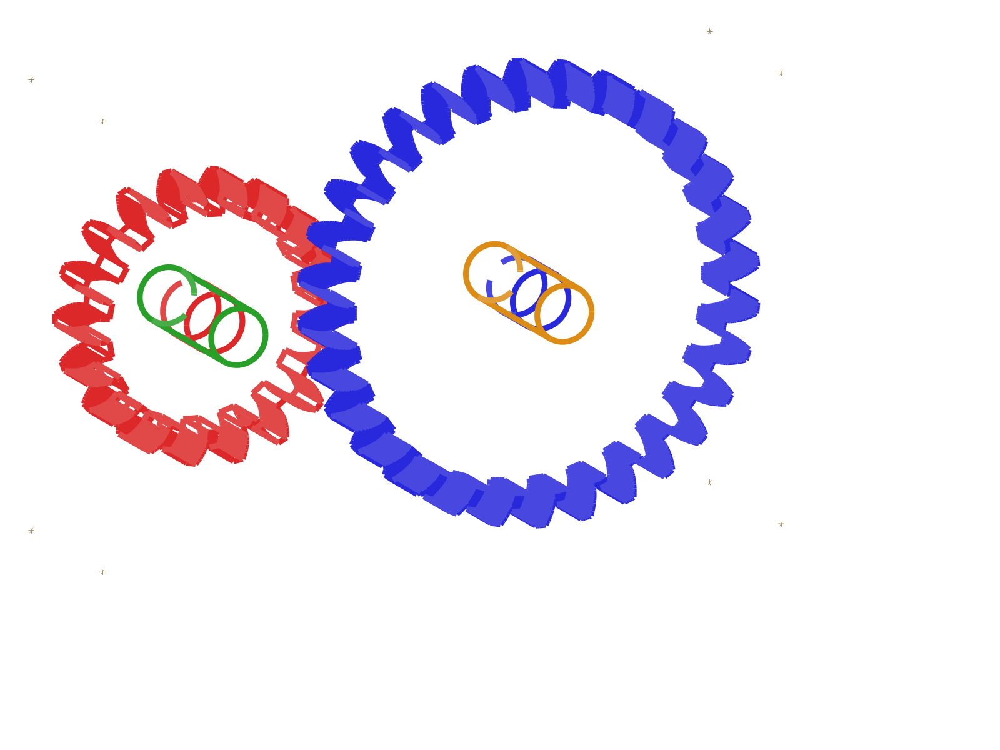

# spur_gear: a meshing involute gear pair, proven to zero interference

> 3 parts · 4-instance meshed assembly · 8 STEP/STL exports (incl. the assembly) ·
> 0 negotiation rounds · 0 repair cycles · single-pass build, ~49.8 min · fully autonomous

**What it is.**
A meshing spur-gear pair on parallel shafts:
an 18-tooth pinion driving a 30-tooth gear
(true involute tooth profiles, module 2 mm, 20° pressure angle, 10 mm face width, ⌀8 mm slip-fit bores),
plus one plain shaft used twice, designed for 3D printing.
The system wrote the parametric CadQuery source for all three parts,
meshed the pair at the correct 48 mm centre distance and half-tooth phase,
validated everything,
and exported STEP + STL for each part and for the assembled pair.

**What it shows.**

- **A geometry class the system had never drawn, shipped in one pass.**
  These are the system's first involute gears,
  and both came out complete in a single design pass:
  zero hallucinated API calls, zero repair cycles,
  the core gear-design phase done in under 8 minutes.
- **Engineering judgment over blind reference-following.**
  The designer agents consulted the reference gear example 18 times,
  detected that its construction method was numerically fragile at these parameters,
  and deliberately switched to a robust point-sampled involute (12-14 samples per flank).
  Reference consultation and independent judgment, both firing on the same run.
- **The mesh is proven with math, not eyeballs.**
  The run verified the gear mesh two independent ways:
  a 2D section-interference check
  (18.04 mm² of tooth overlap at 0° phase → **0.00 mm²** at the −6° half-tooth phase)
  and a full-3D boolean intersection (**0.0000 mm³** at −6° vs a 180.36 mm³ control at 0°),
  and the two agree exactly (18.04 mm² × 10 mm face = 180.36 mm³).
  A volume-conservation check confirms the assembly holds exactly the four intended bodies.
- **Interrupted mid-run, finished anyway.**
  The first session was cut off mid-validation.
  Because the run's entire state lives on the filesystem,
  a fresh session reconstructed where things stood from the files alone
  and carried the design to completion:
  no redesign, zero work lost.

**How to read this run.**

| File | What it is |
|---|---|
| `goals.md` | The design spec the system authored for itself |
| `design_plan.md` | The plan: parts, interfaces, the 48 mm mesh constraint, build order |
| `design_log.md` | The agents' step-by-step build log |
| `run_reflection.md` | **The run's own debrief**: the full story, in the run's own words |
| `assembly/<part>/` | Per-part CadQuery source, renders, and `exports/` (STEP + STL) |
| `assembly/renders/` | Multi-view renders of the meshed pair |
| `assembly/exports/` | STEP + STL of the full assembly |

Produced end-to-end by [AI-CAD](https://github.com/ai-cad-labs/ai-cad).
