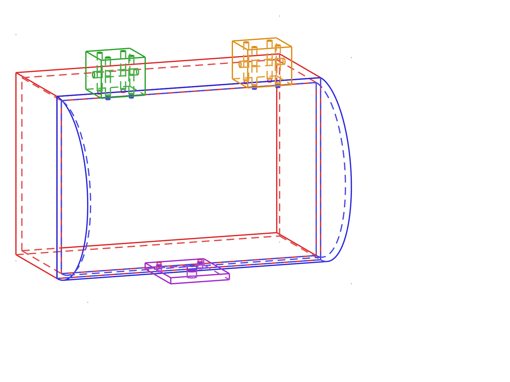

# treasure_chest: four parts, first-pass clean, 33 minutes

> 4 parts · 5-instance assembly · 8/8 STEP/STL exports · 13 agents, 0 failures · 1 round of negotiation iteration · 0 repair cycles · 32.8 min · fully autonomous

**What it is.**
A hinged treasure chest designed for 3D printing:
a hollow base box (180 × 120 × 80 mm, 3 mm walls), a half-cylinder lid,
two hinge blocks bridging the rear seam, and a front hasp plate.
The system planned the four parts, designed them in parallel,
validated each on the first pass, composed and validated the full assembly,
and exported STEP + STL for every part:
one 32.8-minute session, goal to CAD files.

**What it shows.**

- **A straight-through run.**
  13 agents (planner, designers, validators, assembly resolver, reviewer)
  ran the full pipeline with zero agent failures and zero repair cycles;
  every part passed validation on its first attempt,
  and all 8 export files were verified non-empty on disk.
- **It catches and fixes its own fit errors.**
  At assembly time the system detected that the hasp's latch hole
  would land 8 mm off the lid's latch (Z=94 vs the required Z=86),
  filed a one-parameter fix proposal (latch hole 42 → 34),
  passed it through a regression check to prove nothing else degraded,
  and re-validated the assembly clean.
  The whole loop closed without a human touching it.
- **It knows when *not* to "fix" things.**
  Three manufacturability warnings were deferred with written engineering reasoning
  instead of reflexively repaired.
  The hinge-pin bore, for example, must be horizontal for the hinge to function,
  so its print overhang is a property of the design, not a defect.
  Judgment at the strategy layer instead of rule-thrashing on correct-by-intent geometry.
- **Every completion claim is ground-truthed.**
  Validation markers, export file sizes, and every evaluation report
  were independently verified against the files on disk:
  the run's "complete" is a checked fact, not a self-assessment.

**How to read this run.**

| File | What it is |
|---|---|
| `goals.md` | The design spec the system authored for itself |
| `design_plan.md` | The plan: parts, interfaces, the assembled frame, build order |
| `design_log.md` | The agents' step-by-step build log |
| `run_reflection.md` | **The run's own debrief**: the full story, in the run's own words |
| `assembly/<part>/` | Per-part CadQuery source, renders, and `exports/` (STEP + STL) |
| `assembly/renders/` | Multi-view renders of the assembled chest |

Produced end-to-end by [AI-CAD](https://github.com/ai-cad-labs/ai-cad).
